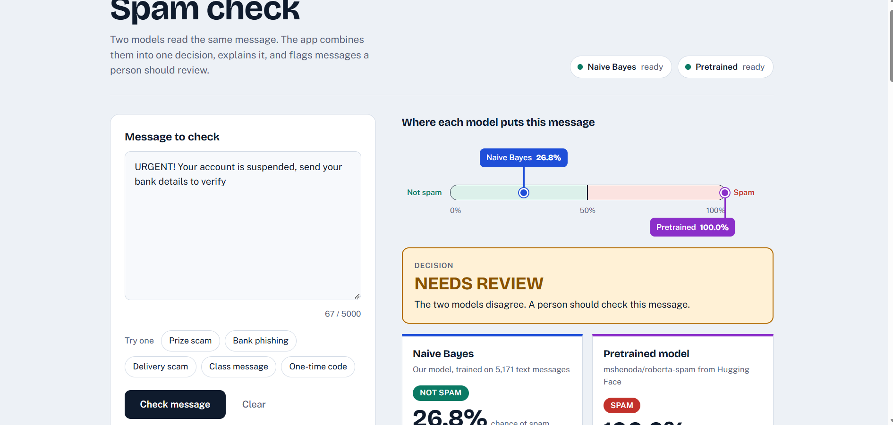
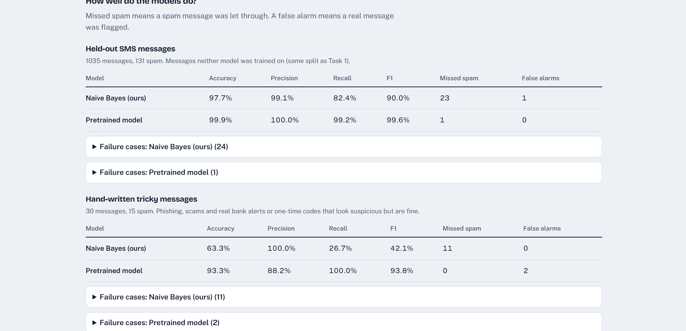
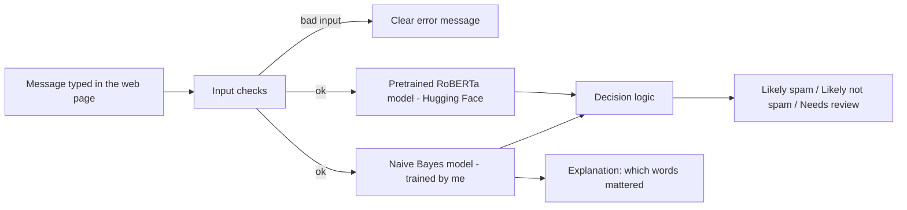

# Spam Check: a two-model spam detector that knows when to ask a human

Final project for the **SWYNEX AI Internship**.

**In one sentence:** you paste a message, two AI models each say how likely it is to be spam, and the app combines them into one clear decision (**Likely spam**, **Likely not spam**, or **Needs review**), explains the decision, and shows how well both models really perform, including where they fail.

You do not need to know machine learning to use it. If you can install Python, you can run it.

---

## Contents
1. [Screenshots](#screenshots)
2. [The problem](#the-problem)
3. [How it works](#how-it-works)
4. [Results](#results)
5. [Try it yourself](#try-it-yourself)
6. [Using the app](#using-the-app)
7. [Limitations](#limitations)
8. [Ethics and responsible use](#ethics-and-responsible-use)
9. [Project structure](#project-structure)
10. [Troubleshooting](#troubleshooting)
11. [Glossary](#glossary)
12. [What I learned and what comes next](#what-i-learned-and-what-comes-next)
13. [Project history and credits](#project-history-and-credits)

---

## Screenshots

| A message the models disagree on | Evaluation and failure cases |
|---|---|
|  |  |

---

## The problem

Unwanted messages are everywhere: fake prize offers, fake bank alerts, fake delivery fees, fake job offers. Some are harmless annoyances. Others steal money or passwords.

**Who it is for:** students and everyday phone or email users who want a second opinion on a suspicious message.

**What the app does:** it reads one message and answers three questions.
1. How likely is this to be spam?
2. Why did the model think so?
3. Can I trust that answer, or should a person look at it?

The third question is the heart of the project. A spam filter that is wrong sometimes is normal. A spam filter that is wrong **and sounds sure** is dangerous. So this app compares two different models and says "Needs review" when they disagree or are unsure.

---

## How it works



### 1. Naive Bayes (my own model)
I trained this model in Task 1 on the public **SMS Spam Collection** (about 5,000 text messages, each labelled spam or not spam). It turns the text into numbers (TF-IDF) and learns which words show up more often in spam, such as "free", "prize", and "claim".

- Strengths: fast, small, and easy to explain.
- Weakness: it only knows the kind of spam it was trained on.

### 2. Pretrained model (from Hugging Face)
`mshenoda/roberta-spam` is a larger language model (RoBERTa) that someone else already trained to detect spam. I plug it in as a second opinion. It downloads automatically the first time you run the app and needs no account or API key.

- Strengths: understands wording and context better.
- Weakness: it is a black box, and I do not fully know what data it was trained on.

### 3. The decision logic
| Naive Bayes | Pretrained model | Decision |
|---|---|---|
| Spam, confident | Spam, confident | **Likely spam** |
| Not spam, confident | Not spam, confident | **Likely not spam** |
| Different answers | | **Needs review** |
| Either one is unsure (35% to 65%) | | **Needs review** |
| Only one model works | | That model's answer, with a note |

### 4. Explanation
For Naive Bayes, the app lists the words that pushed its answer toward spam and the words that pushed it toward not spam, so the result is not a mystery.

### 5. Input checks and error handling
| What you do | What happens |
|---|---|
| Leave the box empty, or type fewer than 3 characters | A clear message appears under the box |
| Type only numbers or symbols | A message says the text has no letters |
| Paste more than 5000 characters | Only the first 5000 are checked, with a warning |
| Type in a language other than English | A warning says the result may be unreliable |
| The pretrained model fails to load | The app keeps working with Naive Bayes only |
| The Naive Bayes model is missing | The app keeps working with the pretrained model only |
| Anything unexpected breaks on the server | A friendly error appears and the details are written to the terminal |

14 automated tests check the input rules and the decision logic (`python -m unittest discover -s tests -v`).

---

## Results

Both models were tested in two ways. All numbers come from `python evaluate.py`, and the full report is in `evaluation_report.md`.

### Test 1: 1,035 held-out text messages
These messages were not used to train my model.

| Model | Accuracy | Precision | Recall | F1 |
|---|---|---|---|---|
| Naive Bayes (mine) | 97.7% | 99.1% | 82.4% | 90.0% |
| Pretrained RoBERTa | 99.9% | 100.0% | 99.2% | 99.6% |

**Read this carefully:** the pretrained model's near-perfect score is probably too optimistic. It may have seen this dataset during its own training, so this test cannot prove it is better.

### Test 2: 30 tricky hand-written messages
15 scams (phishing, fake jobs, fake loans, fake refunds) and 15 real messages that look a little suspicious (bank debit alerts, one-time codes, password-change notices).

| Model | Accuracy | Precision | Recall | F1 |
|---|---|---|---|---|
| Naive Bayes (mine) | 63.3% | 100.0% | 26.7% | 42.1% |
| Pretrained RoBERTa | 93.3% | 88.2% | 100.0% | 93.8% |

### What the numbers mean
- **My Naive Bayes model caught only 4 of the 15 scams.** It learned from short text-message spam, so phishing and job scams written in a different style slip past it. It never wrongly flagged a real message.
- **The pretrained model caught all 15 scams** but wrongly flagged about 2 real messages.
- **Neither model is safe to trust alone.** That is why the app combines them and asks a person to review the messages they disagree on.

The test with 30 messages is small and I wrote it myself, so it shows where the models differ, not how they perform in general.

---

## Try it yourself

### What you need
- A computer with **Python 3.10 or newer** ([python.org](https://www.python.org/downloads/); on Windows tick "Add Python to PATH")
- Internet for the first run (the dataset and the pretrained model are downloaded once)
- About 2 GB of free disk space and a few minutes of patience the first time

### Easiest way (Windows)
1. On the GitHub page, click the green **Code** button, then **Download ZIP**, and unzip it.
2. Double-click **`run_app.bat`**.

It installs the libraries, downloads the dataset, trains the model, runs the evaluation, and opens the app in your browser. The first run takes several minutes. Later runs start in seconds.

### Step by step (any computer)
Open a terminal in the project folder, then run these one at a time:

```
pip install -r requirements.txt
python download_data.py
python spam_classifier.py train --data data/spam.csv
python evaluate.py
python server.py
```

| Step | What it does |
|---|---|
| `pip install ...` | Installs the libraries the project needs |
| `python download_data.py` | Downloads the public SMS spam dataset into `data/spam.csv` |
| `python spam_classifier.py train ...` | Trains my Naive Bayes model and saves it as `spam_model.joblib` |
| `python evaluate.py` | Tests both models and writes the report and failure cases |
| `python server.py` | Starts the app at http://127.0.0.1:5000 |

On Mac or Linux, use `python3` and `pip3` if `python` is not found. Press **Ctrl + C** in the terminal to stop the app.

---

## Using the app

1. Wait until both status chips at the top turn green. The pretrained model can take up to a minute to load.
2. Click one of the example buttons, or paste your own message.
3. Click **Check message** (or press Ctrl + Enter).
4. Read the **decision box** first, then the two model cards and the line showing where each model places the message.
5. Scroll down for the word explanation, your session history, and the evaluation tables with failure cases.

**Good messages to try**
| Message | What you should see |
|---|---|
| "Congratulations! You won a free prize, click http://claim.biz now" | Both say spam |
| "Hi, can you send me the DBMS assignment notes before the lab tomorrow?" | Both say not spam |
| "URGENT! Your account is suspended, send your bank details to verify" | The models disagree, so **Needs review** |
| `12345` | An error message, not a crash |

---

## Limitations

- **English only.** Both models learned from English text.
- **Short messages.** They were trained on text messages, so long emails and newsletters are outside their experience.
- **Old data.** The dataset is a public collection from years ago. Today's scams use different words and tricks, and the models will not know about them.
- **Text only.** The app cannot look at links, attachments, images, or who sent the message.
- **My model misses many scams** that do not look like classic text-message spam (4 of 15 in my tricky test).
- **The pretrained model is a black box.** I could not inspect its training data, and its test score is probably too optimistic.
- **Small stress test.** 30 hand-written messages show the models' weak spots but do not measure general accuracy.
- **Not a security tool.** It gives advice for a human to consider. It should never be the only thing protecting anyone.

---

## Ethics and responsible use

**Mistakes have real costs, in both directions.**
- A *missed scam* can cost someone money or their password.
- A *false alarm* can hide something important, such as an interview invitation, a one-time code, or a message from a doctor.

For that reason the app never claims to be certain. It shows probabilities, explains the decision, and says **Needs review** when the models disagree or are unsure. It is designed to support a person's judgement, not replace it.

**Privacy.**
- Messages you type are processed on your own computer. They are not sent to any online service, and there is no account and no tracking.
- The only internet use is the one-time download of the dataset and the pretrained model.
- No API keys are used anywhere in the code.
- Please do not paste other people's private messages into any tool without their permission.

**Fairness and bias.**
- The models were trained on English text from a specific time and place, so they may treat messages written in other languages, dialects, or styles less fairly. The app warns about non-English text instead of hiding the problem.
- A message is not "spam" just because it is written casually or in an unfamiliar style.

**Honesty about results.**
- The failure cases are shown in the app and in `failure_cases.csv`, not hidden.
- The pretrained model's test score is flagged as possibly optimistic instead of being presented as proof.

**Data and licences.**
- The dataset is the public SMS Spam Collection from the UCI Machine Learning Repository. Check its licence terms before reusing it.
- The pretrained model is `mshenoda/roberta-spam` on Hugging Face. Check its model card for its licence and training details before reusing it.

**Use of AI assistance.** I used an AI assistant to help write and debug parts of the code and documentation, and I ran, tested, and checked the results myself.

**Do not use this app to** make automatic decisions about people, to block messages without a human able to review them, or to claim that a message is definitely safe.

---

## Project structure

```
.
├── README.md              this file
├── run_app.bat            one-click setup and launch for Windows
├── requirements.txt       the libraries the project needs
├── server.py              the web server and API
├── static/                the web page (index.html, style.css, app.js)
├── spam_classifier.py     trains and runs my Naive Bayes model
├── hf_spam.py             loads and runs the pretrained Hugging Face model
├── triage.py              combines both models into one decision
├── explain.py             shows which words influenced Naive Bayes
├── validation.py          checks the input and produces clear errors
├── evaluate.py            tests both models and collects failure cases
├── eval_cases.csv         the 30 hand-written tricky messages
├── download_data.py       downloads the dataset
├── compare.py             command-line comparison on examples.csv
├── examples.csv           example inputs
├── tests/                 automated tests (14)
├── evaluation_report.md   readable evaluation report
├── evaluation_results.json  results used by the web page
├── failure_cases.csv      every mistake the models made
└── docs/                  screenshots used in this README
```

---

## Troubleshooting

| Problem | What to do |
|---|---|
| `python` is not recognised | Reinstall Python and tick **Add Python to PATH**, or try `py` or `python3` |
| `can't open file ... server.py` | You are in the wrong folder. Use `cd` to go into the project folder first, and check with `dir` (Windows) or `ls` |
| The page says "Naive Bayes: model file missing" | Run `python spam_classifier.py train --data data/spam.csv` |
| The Pretrained chip stays on "loading" | Wait a minute. The first start downloads about 500 MB. If it says "unavailable", check your internet connection |
| The first check is slow | The pretrained model is still loading. The next checks are instant |
| `File does not exist: data/spam.csv` | Run `python download_data.py` |
| The browser did not open | Go to http://127.0.0.1:5000 yourself |
| The evaluation section says "No evaluation results yet" | Run `python evaluate.py`, then reload the page |

---

## Glossary

- **Spam:** unwanted or harmful messages, such as scams and fake offers.
- **Model:** a program that learned patterns from examples instead of being given fixed rules.
- **Naive Bayes:** a simple, fast model that counts how often words appear in spam versus normal messages.
- **TF-IDF:** a way of turning text into numbers by giving more weight to distinctive words.
- **Pretrained model:** a model someone else already trained on a lot of data, which you reuse.
- **Accuracy:** the share of all messages classified correctly.
- **Precision:** of the messages flagged as spam, how many really were spam. High precision means few false alarms.
- **Recall:** of all the real spam, how much was caught. High recall means few missed scams.
- **F1 score:** one number that balances precision and recall.
- **False alarm:** a real message wrongly flagged as spam.
- **Missed spam:** a scam that was let through.
- **Held-out test set:** messages kept aside during training so the test is fair.

---

## What I learned and what comes next

**What I learned**
- A high score on one test does not mean a model is good. My own model scored 97.7% on text-message data but caught only 4 of 15 scams written in a different style.
- Comparing two models is more useful than trusting one, because disagreement is a warning sign.
- Showing failures honestly makes a project more trustworthy, not less.
- Good error messages are part of the product. A crash is a bad answer.

**Ideas for next steps**
- Test on a larger, independent set of real phishing emails.
- Add support for more languages.
- Retrain on newer scam examples and add a button for users to report mistakes.
- Look at links and sender details, not only the text.

---

## Project history and credits

| Task | What I built |
|---|---|
| Task 1: AI Problem Design | Chose the problem, user, data, constraints, and evaluation plan; trained the Naive Bayes classifier |
| Task 2: Model Integration | Added the pretrained Hugging Face model and a side-by-side comparison web app |
| Task 3: Intelligent Feature | Added the combined decision, explanations, error handling, tests, and an evaluation with failure cases |
| Task 4: Final AI Application | Packaged everything with a one-click launcher and this README |

**Built with:** Python, scikit-learn, Hugging Face Transformers (PyTorch), Flask, pandas, and plain HTML, CSS, and JavaScript.

**Data and models:** SMS Spam Collection (UCI Machine Learning Repository); `mshenoda/roberta-spam` (Hugging Face).

Made as part of the SWYNEX Technologies AI Internship.
